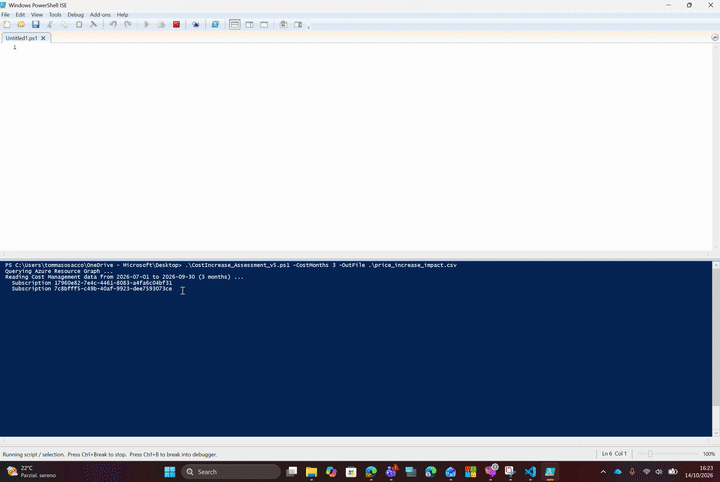

# Azure Cost Increase Assessment

This script finds the Azure resources affected by the price increases effective **1 February 2027** and estimates the monthly and annual increase for each one. It writes the result to a single CSV file.

> **Disclaimer.** The output is an **estimate** intended to give an indication of the potential impact. The final impact depends on the actual usage of the resources, on the applicable commercial agreement and on commitments (Reserved Instances, Savings Plans), and must be verified against actual billing. The same disclaimer is written at the top of the CSV file.

The cost baseline comes from **Cost Management**, meaning what the customer was actually billed, with discounts, Azure Hybrid Benefit and real running hours already included. The public list price is used only when a resource has no billed usage in the period analysed.

---

## Demo

[](./media/regional-and-vm-price-increases-demo.gif)

[Open the demo at full size](./media/regional-and-vm-price-increases-demo.gif).

---

## 1. Prerequisites

| Requirement | Details |
|---|---|
| PowerShell | 7.x recommended; also works with Windows PowerShell 5.1 |
| Modules | `Az.Accounts` and `Az.ResourceGraph` |
| Permissions | **Reader** and **Cost Management Reader** on the subscriptions to analyse |
| Network | HTTPS access to `management.azure.com` and `prices.azure.com` |

Install the modules (one time only):

```powershell
Install-Module Az.Accounts, Az.ResourceGraph -Scope CurrentUser
```

On Enterprise Agreement enrolments, cost data is only visible at subscription level if the enrolment allows it (*AO view charges* enabled). If it is disabled, the Cost Management queries fail and the script falls back to list prices.

---

## 2. How to run it

```powershell
# 1. Sign in to the tenant you want to analyse
Connect-AzAccount -Tenant <tenant-id-or-domain>

# 2. Only if Windows blocks the downloaded file
Unblock-File .\CostIncrease_Assessment_v5.ps1

# 3. Run
.\CostIncrease_Assessment_v5.ps1 -CostMonths 3 -OutFile .\price_increase_impact.csv
```

| Parameter | Default | Description |
|---|---|---|
| `-CostMonths` | `3` | Number of full past months used to calculate the monthly average |
| `-OutFile` | `.\azure_price_increase_impact.csv` | Path of the generated CSV |
| `-Currency` | `EUR` | Currency used **only** for the list-price fallback. Set it to the customer's billing currency, otherwise the totals mix currencies |
| `-NoListPriceFallback` | off | Do not use list prices at all: only billed data appears in the output |
| `-UseAssumedStorageExclusions` | off | Also excludes legacy *Blob Storage* meters (Hot/Cool/Archive), which are not in the published exclusion list |
| `-NoDisclaimerInCsv` | off | Writes a plain CSV without the disclaimer lines at the top (useful for automated processing) |

The script analyses every subscription in the tenant that the signed-in user can access. For another customer, run `Connect-AzAccount` again against their tenant.

With many subscriptions, the Cost Management API may throttle requests (HTTP 429). The script waits and retries automatically.

---

## Azure SRE Agent plugin

This folder is also a standalone Azure SRE Agent plugin. It imports the `azure-cost-increase-assessment` skill, which applies the same pricing rules through the agent's built-in read-only Azure tools and sandboxed code execution. It does not change Azure resources and does not require PowerShell in the SRE sandbox.

### SRE prerequisites

- An Azure SRE Agent in **Running** state
- **SRE Agent Author** or **Administrator** role on the agent
- The **Plugins** page under **Builder**
- **Reader** and **Cost Management Reader** assigned to the SRE Agent managed identity for the subscriptions to assess

### Install from this repository

1. In the [Azure SRE Agent portal](https://sre.azure.com), open the agent.
2. Go to **Builder > Plugins** and select **Install from URL**.
3. Enter `DevOpsStyle/AzureUtilities` as the GitHub repository URL.
4. Enter `utilities/azure-cost-increase-assessment` as **Path in repo**.
5. Select **Install**.
6. Verify that `azure-cost-increase-assessment` appears under **Builder > Skill builder** or **Agent Canvas**.

The installation is pinned to the current Git commit. After changing the skill in this repository, explicitly update or reinstall the plugin on each agent that should receive the new version.

The equivalent REST request body is:

```json
{
  "sourceUrl": "DevOpsStyle/AzureUtilities",
  "pathInRepo": "utilities/azure-cost-increase-assessment"
}
```

Example prompts:

```text
Assess the impact of the Azure price increases effective 1 February 2027 across all subscriptions you can access. Use the last three complete months and EUR for retail fallback.
```

```text
Which resources in subscription <subscription-id> are affected by the February 2027 Azure price increases? Produce a CSV and separate totals by currency.
```

The skill is an instruction-based workflow modeled on the [Azure SRE Agent plugin format](https://learn.microsoft.com/azure/sre-agent/install-plugin-from-url). The local PowerShell script remains the reference implementation for interactive use outside Azure SRE Agent.

---

## 3. Pricing rules applied

The rules below reflect the Azure VM lifecycle and pricing changes announced on 28 September 2026.

### 3.1 Virtual machines

Each VM gets **one regime only**. The two increases never stack.

| VM series | Increase | Where |
|---|---|---|
| Listed v1: Bv1, D, Ds, F, Fs, G, Gs, Ls, NP, HC | **+25%** | All regions |
| Listed v2: Av2, Amv2, Dv2, Dsv2, Fsv2, Lsv2 | **+25%** | All regions |
| v3–v6 and AMD v7 (e.g. Dasv7, Easv7, Fasv7) | **Regional %** | The 7 affected regions only |
| Intel v7: Dsv7, Ddsv7, Dlsv7, Dldsv7, Esv7, Edsv7 | **None** | All regions |
| v1/v2 SKUs **not** on the lists above | **Regional %** | The 7 affected regions only |

VM series are identified from the size name, e.g. `Standard_DS2_v2` → Dsv2 → +25%; `Standard_D4s_v5` in North Europe → +17%; `Standard_D4s_v7` → no increase.

### 3.2 Regional percentages

| Region | Increase |
|---|---|
| North Europe (Dublin) | +17% |
| France Central, France South | +11% |
| West Europe (Amsterdam) | +9% |
| Norway East, Norway West | +9% |
| Southeast Asia (Singapore) | +8% |

### 3.3 Storage

The regional increase also applies to selected Storage services in the 7 regions. Resources analysed: Managed Disks, Storage Accounts, Azure NetApp Files capacity pools, Elastic SAN.

Meters on the published exclusion list are removed from the cost baseline: Azure Container Storage, Azure Managed Lustre, Azure NetApp Files Cross Region Replication SKU, Blob Features, Change Feed, General Block Blob, Import/Export, Queues, Queues v2, Standard Page Blob, Storage Actions, Storage Bandwidth, Storage Discovery, Tables, Transaction Optimized SKU.

The matching also covers "v2" variants of these names (for example *General Block Blob v2*). Storage figures are therefore an approximation: the exact impact depends on the meters actually billed.

### 3.4 Commitments

| Pricing model | Affected from 1 Feb 2027? | How the script treats it |
|---|---|---|
| Pay-as-you-go / EA / MCA on-demand | Yes | Included in the baseline |
| **Savings Plan** | **Yes**: covered usage reflects the new underlying rates | Included in the baseline |
| **Reserved Instance** | No, until the reservation expires | Excluded from the baseline |
| Spot | Not addressed by the guidance | Not included |

New Reserved Instances can no longer be purchased for v1–v3 series. When an existing RI on those series expires, the usage goes back to pay-as-you-go and picks up the increase.

---

## 4. How the cost is calculated

### 4.1 Inventory

The script runs three **Azure Resource Graph** queries:

1. VMs and VM Scale Sets: size, OS, power state, instance count.
2. Managed Disks in the 7 regions: SKU, size, tier, provisioned IOPS and throughput, state.
3. Storage Accounts, NetApp capacity pools and Elastic SAN in the 7 regions.

### 4.2 Billed cost (Cost Management)

For each subscription it calls the Cost Management Query API twice, over the last `-CostMonths` full months:

| Query | Cost type | Grouped by | Used for |
|---|---|---|---|
| A | Actual cost, `PricingModel = OnDemand` only | Resource, meter subcategory | On-demand cost, with excluded storage meters removed |
| B | Amortized cost | Resource, pricing model | Savings Plan cost and RI / SP / on-demand coverage shares |

Values are divided by `-CostMonths` to get a monthly average.

### 4.3 Choosing the baseline

| Situation | `CostSource` | `BaseMonthlyCost` |
|---|---|---|
| Billed on-demand and/or Savings Plan usage in the period | `Cost Management (OnDemand + Savings Plan)` | Subject on-demand cost + Savings Plan amortized cost |
| Usage fully covered by Reserved Instances | `Cost Management (fully covered by RI)` | 0 until the RI expires |
| No billed usage (VM deallocated all period, new resource) | `Retail list price (<currency>)` | List price estimate |
| No data and no list price | `None` | Empty |

Then:

$$\text{EstimatedMonthlyIncrease} = \text{BaseMonthlyCost} \times \frac{\text{ExpectedIncreasePct}}{100}$$

$$\text{EstimatedAnnualIncrease} = \text{EstimatedMonthlyIncrease} \times 12$$

### 4.4 List-price fallback

List prices come from the public **Azure Retail Prices API** (`https://prices.azure.com/api/retail/prices`), the same source as the Pricing Calculator.

| Resource | Method |
|---|---|
| VMs | Hourly pay-as-you-go price for the size and region (Spot and Low Priority excluded, Windows/Linux distinguished) × 730 hours × instances. Windows prices include the OS licence |
| Premium SSD, Standard SSD, Standard HDD | Monthly price of the disk tier (P/E/S + number) derived from disk size |
| Premium SSD v2 | Hourly price of capacity + IOPS above 3,000 + throughput above 125 MBps, × 730 |
| Ultra Disk | Hourly price of capacity + IOPS + throughput, × 730 (vCPU reservation charge not included) |
| Storage Accounts, NetApp, Elastic SAN | No fallback: they are usage-based, so only billed data is used |

---

## 5. Reading the output

### 5.1 Disclaimer and on-screen summary

The first three lines of the CSV contain the disclaimer, followed by an empty line and then the table. The console also prints an *ESTIMATE ONLY* reminder.


```
Managed Disk         resources:   120  (Cost Mgmt: 112, list price: 8)  estimated monthly increase:     1,234.56
Storage Account      resources:    35  (Cost Mgmt: 30, list price: 0)   estimated monthly increase:       456.78
Virtual Machine      resources:    80  (Cost Mgmt: 71, list price: 9)   estimated monthly increase:     5,678.90
```

The counts show how many rows are based on billed data and how many on list-price estimates.

### 5.2 CSV columns

| Column | Meaning |
|---|---|
| `Category` | Virtual Machine, Managed Disk, Storage Account, Azure NetApp Files, Elastic SAN |
| `SubscriptionId`, `ResourceGroup`, `Name`, `Type`, `Location` | Resource identification |
| `Sku` | VM size, or disk/storage SKU and size |
| `Quantity` | 1 for VMs, `sku.capacity` for VM Scale Sets |
| `OsType` | Windows / Linux (VMs only) |
| `State` | VM power state or disk state |
| `IncreaseRegime` | `v1/v2 series increase` or `Regional increase` |
| `ExpectedIncreasePct` | 25, 17, 11, 9 or 8 |
| `CostSource` | Where the baseline comes from (see 4.3) |
| `Currency` | Billing currency, or `-Currency` for list-price rows |
| `BaseMonthlyCost` | Monthly cost the increase is applied to |
| `EstimatedMonthlyIncrease` | Estimated monthly increase |
| `EstimatedAnnualIncrease` | Estimated annual increase (× 12) |
| `ActualOnDemandMonthly` | Billed on-demand cost, all meters, monthly average |
| `ActualSubjectMonthly` | Billed on-demand cost on meters subject to the increase |
| `SavingsPlanMonthly` | Amortized Savings Plan cost, monthly average |
| `AmortizedMonthlyTotal` | Total amortized cost (on-demand + RI + SP), monthly average |
| `OnDemandSharePct`, `ReservationSharePct`, `SavingsPlanSharePct` | Share of amortized cost by pricing model |
| `ListPriceMonthly` | List-price estimate (for reference, even when not used) |
| `Notes` | Warnings for that row |
| `ResourceId` | Full resource ID |

### 5.3 Cases to check

| What you see | What it means | What to do |
|---|---|---|
| `CostSource = Retail list price` on a VM with `State = PowerState/deallocated` | VM was off for the whole period; the estimate assumes it runs 24/7 | Exclude it from the total or confirm with the customer whether it will be restarted |
| `ReservationSharePct` between 0 and 100 | Part of the usage is covered by an RI and is excluded from the baseline | When the RI expires, that part will also pick up the increase |
| `CostSource = Cost Management (fully covered by RI)` | No increase today | Check the RI expiry date in **Portal → Reservations**: the increase starts from then |
| `SavingsPlanMonthly > 0` | Savings Plan usage is included in the baseline | Expected behaviour: SP reflects the new rates |
| VM Scale Set in **Flexible** orchestration mode | Instances are billed and listed as individual VMs | The VMSS row itself may get a list-price estimate: ignore it to avoid double counting |
| `CostSource = None` | No billed data and no list price | Check the price manually |
| `OsType = Windows` on a list-price row | List price includes the Windows licence | If the customer uses Azure Hybrid Benefit, the real cost is lower |
| `State = Unattached` on a disk | Disk not attached but still billed | Candidate for removal |

### 5.4 Opening the CSV in Excel

Because of the disclaimer lines, when importing set Excel to start from **row 5** (the header row), or run the script with `-NoDisclaimerInCsv`.

The file uses a comma as separator and a dot as decimal separator. With non-English regional settings (for example Italian), double-clicking may put everything in one column or misread numbers. Use **Data → From Text/CSV**, choose *Delimiter: Comma* and set the locale to *English (United States)* for the numeric columns.

---

## 6. Azure Resource Graph quick checks

The following read-only queries can be run independently in [Azure Resource Graph Explorer](https://portal.azure.com/#view/HubsExtension/ArgQueryBlade). They provide a quick inventory of affected compute resources and managed disks without running the full cost assessment. The PowerShell script uses extended versions of these queries so it can also calculate cost estimates.

### 6.1 Virtual machines and Virtual Machine Scale Sets

```kusto
Resources
| where type in~ ("microsoft.compute/virtualmachines", "microsoft.compute/virtualmachinescalesets")
| extend vmSize = iff(type =~ "microsoft.compute/virtualmachines", tostring(properties.hardwareProfile.vmSize), tostring(sku.name))
| extend instances = iff(type =~ "microsoft.compute/virtualmachinescalesets", toint(sku.capacity), 1)
| extend s = tolower(vmSize), region = tolower(location)
| extend isV1 = s matches regex "^standard_(b[0-9]+(ls|s|ms)|d[0-9]+(-[0-9]+)?|ds[0-9]+(-[0-9]+)?|f[0-9]+s?|g[0-9]+|gs[0-9]+(-[0-9]+)?|l[0-9]+s|np[0-9]+s|hc[0-9]+(-[0-9]+)?rs)(_promo)?$"
| extend isV2 = s matches regex "^standard_(a[0-9]+m?|ds?[0-9]+(-[0-9]+)?|f[0-9]+s|l[0-9]+s)_v2(_promo)?$"
| extend isIntelV7 = s matches regex "^standard_(d[0-9]+(-[0-9]+)?(s|ds|ls|lds)|e[0-9]+(-[0-9]+)?(s|ds))_v7$"
| extend regionalPct = case(region == "northeurope", 17, region in ("francecentral", "francesouth"), 11, region in ("westeurope", "norwayeast", "norwaywest"), 9, region == "southeastasia", 8, 0)
| extend expectedIncreasePct = case(isV1 or isV2, 25, regionalPct > 0 and isIntelV7 == false, regionalPct, 0)
| extend increaseRegime = case(isV1 or isV2, "v1/v2 series increase", expectedIncreasePct > 0, "Regional increase", "Not affected")
| where expectedIncreasePct > 0
| project subscriptionId, resourceGroup, name, type, location, vmSize, instances, increaseRegime, expectedIncreasePct, id
| order by expectedIncreasePct desc
```

### 6.2 Managed disks

```kusto
Resources
| where type =~ "microsoft.compute/disks"
| extend region = tolower(location)
| extend regionalPct = case(region == "northeurope", 17, region in ("francecentral", "francesouth"), 11, region in ("westeurope", "norwayeast", "norwaywest"), 9, region == "southeastasia", 8, 0)
| where regionalPct > 0
| project subscriptionId, resourceGroup, name, location, diskSku = tostring(sku.name), diskSizeGB = toint(properties.diskSizeGB), diskState = tostring(properties.diskState), regionalPct, id
```

---

## 7. Limitations

- **Past consumption as forecast.** The baseline is the average of past months with constant volumes. Growth, decommissioning and autoscale changes are not projected.
- **Cost Management latency.** Data arrives with roughly 24–48 hours delay. Resources created after the analysed period only get a list-price estimate.
- **Spot VMs** are not included in the baseline. If a VM runs only on Spot, it falls back to a list-price estimate, which overstates the impact.
- **Not in scope**: disk snapshots, Dedicated Hosts, Azure Batch pools, Azure Backup, Azure VMware Solution, PaaS compute. These are not covered by this estimate.
- **Mixed currencies.** If `-Currency` differs from the billing currency, list-price rows and billed rows are summed together in the on-screen totals. Set `-Currency` to the billing currency.
- **Future list prices.** If Microsoft publishes the February 2027 prices in the Retail API before you run the script, the list-price fallback may pick up a price that already includes the increase and apply it a second time. Check `effectiveStartDate` in the API response when that date approaches.
- **Storage** figures are approximate: the impact depends on which meters are actually billed.

---

## 8. References

- Microsoft announcement on Azure VM lifecycle, retirements and pricing updates (28 September 2026)
- Azure Retail Prices API: https://learn.microsoft.com/rest/api/cost-management/retail-prices/azure-retail-prices
- Cost Management Query API: https://learn.microsoft.com/rest/api/cost-management/query
- Azure Resource Graph Explorer: https://learn.microsoft.com/azure/governance/resource-graph/first-query-portal
- `Search-AzGraph`: https://learn.microsoft.com/powershell/module/az.resourcegraph/search-azgraph
